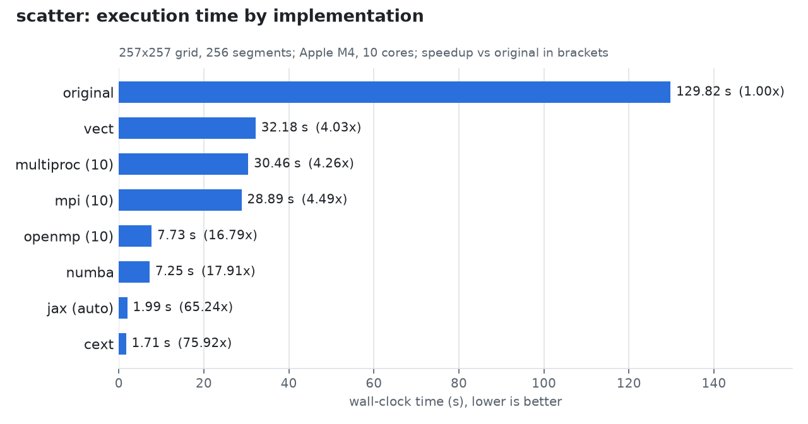
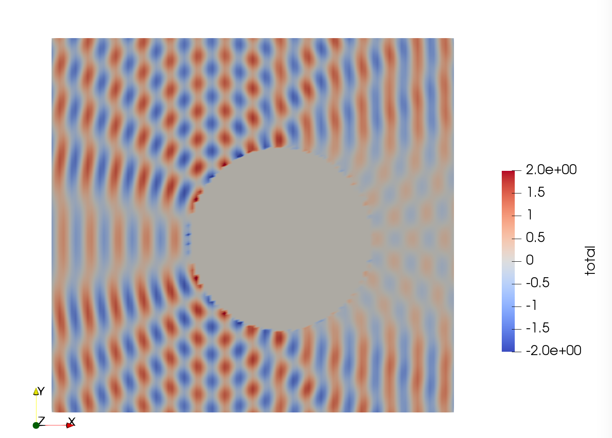

# scatter

Scatter is a simple program that computes the scattering of an incident wave on a 2D
object. The total wave (incident + scattered) satisfies homogeneous Neumann boundary
conditions on the obstacle.

The numerical method integrates Green's functions along the boundary and 
requires that the normal derivative of the scattered wave cancels the normal 
derivative of the incident wave there. Using the assumption that the wavelength is much 
smaller than the size of the obstacle, the total wave amplitude is approximately set to zero on
the shadow side. On the illuminated side, the scattered amplitude set to the incident wave 
amplitude as described in Morse and Feshbach, Methods of Theoretical Physics, pp 1551-1552.

The numerical approach involves looping over observer points, nodes on a uniform grid, with the 
scattered wave amplitude computed by summing all the reflection contributions from each boundary 
segment.

This program shows how a Python code can be modified to run faster using various techniques. 

## Requirements

 * Python >= 3.12 (tested 3.12, 3.13)
 * NumPy >= 2, SciPy, Numba (numba variant), JAX (jax variant), mpi4py + an MPI library (mpi variant), setuptools
 * Boost (header-only parts, tested 1.92) and a C++ compiler (cext, numba, openmp variants)
 * OpenMP runtime (openmp variant; on macOS `brew install libomp`)

## Setting up the environment

```
python3 -m venv .venv    # or: uv venv .venv
source .venv/bin/activate
pip install -r requirements.txt   # mpi4py needs mpicc on the PATH (e.g. brew install open-mpi)
```
The C++ variants (`cext`, `numba`, `openmp`) must be built first, from inside their directory:
```
BOOST_DIR=<path-to-boost> python setup.py build
```
`BOOST_DIR` defaults to `/opt/homebrew` or `/usr/local`. The `mpi` variant is run with
`mpirun -n 4 python scatter.py -checksum`.

## Directory layout

The directories below 
```
|-\
   |-original
   |-vect
   |-numba
   |-cext
   |-multiproc
   |-mpi
   |-openmp
   |-jax

```
contain different versions of the scatter code, all producing the same result but each having 
a different implementation. For instance `vect` has a vectorised implementation and `cext` 
has some functions coded in C++ for additional speed. `jax` uses JAX to compile and vectorise the whole computation. 

## Exercises and solutions

The top-level directories above contain the exercises: `vect`, `numba`, `multiproc`, `mpi` and
`openmp` have parts for you to complete (look for `TO DO`, `VECTORISE`, `ADD OPENMP PRAGMA HERE`
and similar comments). The completed versions live in `solutions/`, which mirrors the layout above.
`ci/check_all.sh` and `ci/check_all.sh solutions` build and check the checksum of each set, and
`pytest` (`pip install -r requirements-dev.txt`) compares the computed fields point by point
with the `original` version.

## Performance

Execution time of each version on a 257x257 grid with 256 contour segments (`python benchmarks/run_benchmarks.py`
reproduces this; `solutions/` versions are timed):

Problem: nx=256 ny=256 nc=256 (66049 observer points x 256 segments).  
Machine: Apple M4, 10 cores, Darwin 25.6.0, Python 3.13.16.  
Wall-clock time of the whole run, best of 1.

| variant | workers | time (s) | speedup vs original |
|---|---:|---:|---:|
| original | 1 | 129.82 | 1.00x |
| vect | 1 | 32.18 | 4.03x |
| numba | 1 | 7.25 | 17.91x |
| cext | 1 | 1.71 | 75.92x |
| multiproc | 10 | 30.46 | 4.26x |
| mpi | 10 | 28.89 | 4.49x |
| openmp | 10 | 7.73 | 16.79x |
| jax | auto | 1.99 | 65.24x |



These are single runs on one laptop and include start-up and JIT compilation time, so treat small
differences as noise. Note that `openmp` is slower than the serial `cext` here: with only 256 segments
per observer point the threading overhead outweighs the work.

## How to run the code

Regardless of the version of the code, use
```
python scatter.py
```
If you change the code and need to verify that the result has not changed, 
```
python scatter.py -checksum
Sum of scattered field |amplitudes|^2: 4686.33935547
```
as this will print out a check sum. Additional options can be invoked to adjust the problem size
and other parameters (type `python scatter.py --help` for a full list). The result can be saved in a VTK file using
```
python scatter.py -save
``` 
VisIt, Paraview and other tools can then be used to visualise the field.




